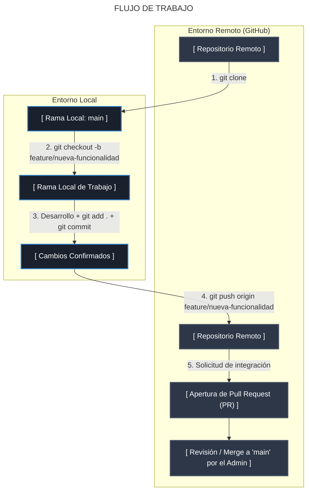

# Manual de Procedimientos y Gobernanza para la Gestión Colaborativa de Repositorios en GitHub

## 1. Declaración de Principios y Estructura de Control

La administración y el desarrollo colaborativo de software mediante repositorios distribuidos en la plataforma GitHub exigen la observación rigurosa de un protocolo estandarizado. La integridad del código fuente, la trazabilidad de los cambios y la segregación de responsabilidades son garantizadas a través de este marco operativo.


## 2. Configuración Inicial e Infraestructura del Repositorio

> [!IMPORTANT]
> Este apartado es exclusivo para el rol **administrador**.

La fase de aprovisionamiento del entorno centralizado es ejecutada de forma exclusiva por la figura asignada como Administradora del repositorio.

1. **Aprovisionamiento del Repositorio Central:**
   * La sesión en la plataforma GitHub es iniciada mediante las credenciales institucionales.
   * La creación del nuevo repositorio es ejecutada a través de la interfaz de administración.
   * La denominación del proyecto es asignada conforme a las nomenclaturas corporativas.
   * La visibilidad (Privada o Pública) es dictaminada según los requerimientos de confidencialidad del proyecto.
   * La inicialización del repositorio es efectuada mediante la inclusión explícita del archivo `README.md`.

2. **Gestión de Accesos y Asignación de Roles:**
   * La sección de configuración (*Settings*) es accedida dentro del repositorio administrado.
   * El módulo de colaboradores (*Collaborators*) es seleccionado para la incorporación de personal.
   * Las invitaciones son cursadas a los miembros del equipo a través de sus identificadores oficiales de GitHub o direcciones de correo electrónico.
   * Los niveles de autorización (Lectura, Escribir, Administración) son preconfigurados de acuerdo con la matriz de responsabilidades establecida.

3. **Implementación de Políticas de Protección de Ramas (*Branch Protection Rules*):**
   * Las reglas de protección son aplicadas sobre la rama principal (denominada `main` o `master`).
   * La restricción de escritura directa es activada de forma obligatoria.
   * La exigencia de Solicitudes de Extracción (*Pull Requests*) previas a la fusión (*Merge*) es parametrizada.
   * La aprobación formal por parte del rol Administrador o revisor designado es configurada como requisito indispensable para la integración de código.


## 3. Protocolo de Trabajo Local y Flujo Operativo

El ciclo de desarrollo continuo es ejecutado de manera uniforme por todos los participantes del proyecto, observando la separación entre el código de producción y el desarrollo de funcionalidades.



1. **Clonación del Repositorio:**
   * La réplica local del repositorio remoto es obtenida mediante la ejecución del comando:
     ```bash
     git clone <URL_DEL_REPOSITORIO>
     ```
   * La navegación hacia el directorio de trabajo es realizada a través de la instrucción:
     ```bash
     cd <NOMBRE_DEL_REPOSITORIO>
     ```

2. **Aislamiento de Funcionalidades mediante Ramificaciones:**
   * La sincronización previa de la rama principal es ejecutada:
     ```bash
     git checkout main
     git pull origin main
     ```
   * Una rama secundaria es creada y seleccionada para el desarrollo de la tarea específica:
     ```bash
     git checkout -b feature/denominacion-de-la-tarea
     ```

3. **Confirmación de Cambios (*Commits*):**
   * Las modificaciones efectuadas son indexadas al área de preparación (*Staging Area*):
     ```bash
     git add .
     ```
   * El estado del trabajo es registrado en el historial local mediante un mensaje descriptivo redactado en modo imperativo:
     ```bash
     git commit -m "M1" -m "M2"
     ```
    > En el mensaje 1 (_M1_) se indicará la descripción técnica y concisa de la modificación realizada, mientras en el mensaje 2 (_M2_) es de modo opcional y se empleará para detallar y expandir la información de la modificación.

4. **Publicación Remota de la Rama:**
   * La rama de trabajo local es transferida al servidor remoto:
     ```bash
     git push -u origin feature/denominacion-de-la-tarea
     ```


## 4. Proceso de Integración, Revisión y Fusión de Código

La consolidación del código en la rama de producción es regulada a través del mecanismo de verificación entre pares.

1. **Apertura de la Solicitud de Extracción (*Pull Request*):**
   * La interfaz web de GitHub es accedida por el desarrollador autor de la modificación.
   * La Solicitud de Extracción es formalizada seleccionando la rama de origen (*feature*) y la rama de destino (*main*).
   * Una justificación detallada de los cambios es provista en el cuerpo de la solicitud.

2. **Auditoría y Fusión (Rol Administrador):**
   * El código propuesto es inspeccionado en la pestaña de archivos modificados (*Files changed*).
   * La conformidad con los estándares de calidad del proyecto es evaluada.
   * La fusión (*Merge*) es ejecutada exclusivamente si las pruebas de integración son superadas y la revisión es dictaminada favorablemente.
   * La rama secundaria en el entorno remoto es depurada posterior a la fusión.

3. **Re-sincronización del Entorno Local (Todos los Roles):**
   * La rama principal local es re-seleccionada y actualizada tras la inclusión de nuevos cambios:
     ```bash
     git checkout main
     git pull origin main
     ```


## 5. Consideraciones Adicionales y Aspectos Avanzados de Operación

Ciertos escenarios operacionales de complejidad técnica superior requieren atención especializada y no forman parte del flujo ordinario de trabajo. Dichos eventos deben ser gestionados con extrema precaución.

* **Resolución de Conflictos de Fusión (*Merge Conflicts*):** Ocurren cuando modificaciones incompatibles son introducidas de forma simultánea sobre las mismas líneas de un archivo por distintos colaboradores.

> [!NOTE]
> La metodología de resolución manual de conflictos mediante la edición de marcas de divergencia (`<<<<<<<`, `=======`, `>>>>>>>`) debe ser investigada de forma independiente.

* **Reversión de Confirmaciones (*Git Revert / Reset*):** La alteración o anulación del historial de cambios en ramas compartidas debe ser evitada salvo instrucciones explícitas de la administración.
  
> [!NOTE]
> La teoría sobre la manipulación del árbol de historial de Git debe ser objeto de estudio específico.

* **Reorganización del Historial (*Git Rebase*):** La reestructuración lineal de solicitudes de extracción avanzadas exige un dominio profundo de las herramientas de CLI.
  
> [!NOTE]
> La documentación oficial sobre el comando `git rebase` debe ser consultada con carácter previo a su aplicación en entornos de producción.

## Notas

Este documento ha sido redactado mediante asistentes de inteligencia artificial y supervisado por **@rosendocamal**.
